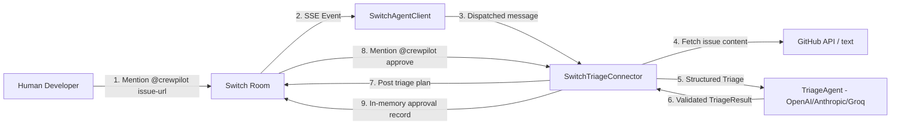
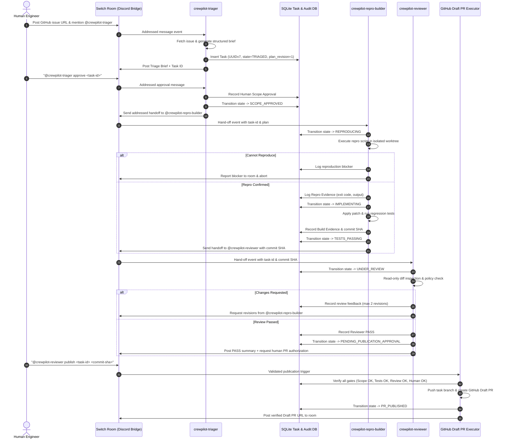

# CrewPilot Architecture & Squad Workflow Specification

**Status:** Target Design Specification (M0 Preparation Baseline)  
**Date:** 2026-11-01  
**Project:** CrewPilot — Evidence-Driven Bug Investigation Squad  
**Track:** Flip the Switch Hackathon — Best Business Workflow  

---

## 1. Executive Overview & Design Principles

CrewPilot bridges the chasm between messy, ambiguous bug reports in team chat and auditable, tested code changes on GitHub. The system coordinates human engineers and autonomous agents through **Switch** as the central collaboration bus.

### Core Architecture Axioms:
1. **Switch is Essential, Not Decorative:** All agent-to-human and agent-to-agent communication passes through Switch rooms and addressed messages. Removing Switch stops the collaboration workflow entirely.
2. **Documented SSE/HTTP Transport:** The squad operates over the official Switch agent protocol (`sandbox-quantum/switch`): SSE stream down (`GET /agents/{id}/events`) and authenticated HTTP operations up (`POST /agents/{id}/ops/{op}`). No WebSockets are used.
3. **Genuinely Independent Personas:** Rather than a single monolithic prompt masquerading as multiple roles, CrewPilot operates three distinct agents with separate Switch credentials, distinct execution lifecycles, and isolated security boundaries.
4. **Evidence-Driven State Transitions:** No code change advances without deterministic proof (exit code 0, recorded command stdout/stderr, diff hashes).
5. **Zero-Trust Input & Least-Privilege Execution:** Bug reports and generated code are untrusted. Code execution happens in isolated worktrees without access to system tokens or private environments.

---

## 2. Implemented Baseline: Single-Agent Auto-Triager (M0)

The pre-hackathon codebase represents an MVP single-agent Auto-Triager.

### Components of Implemented Baseline:
- `main.py`: Entrypoint initializing `Settings`, `TriageAgent`, `SwitchAgentClient`, and `SwitchTriageConnector`.
- `config.py`: Configuration validation supporting OpenAI, Anthropic, and Groq providers.
- `github_issues.py`: Non-authenticated or bearer-authenticated read-only issue fetcher with 8,000 character limit.
- `agent/triage_agent.py`: Structured JSON extractor enforcing schema (`category`, `severity`, `difficulty`, `summary`, `suggested_fix_plan`).
- `switch/agent_client.py`: Transport client receiving SSE event stream down (`/events`) and dispatching operations up (`/ops/*`) with keepalive heartbeats (`/connection/beat`).
- `switch/switch_connector.py`: Address-filtering connector routing commands, storing in-memory approvals (`_pending`), and handling decisions.

### Known Architectural Limitations of Implemented Baseline:
- **Volatile State:** `_pending` dict and `_seen_messages` deduplication cache are stored in process RAM; server restart wipes all state.
- **Unsafe Approval Binding:** `_find_pending` in `switch_connector.py` falls back to the most recent triage in the room if the thread ID does not match (P0 cross-thread hijacking risk).
- **Single Agent Only:** No Builder, Reproducer, or Reviewer roles.
- **Read-Only:** No code execution, worktree management, or GitHub writing capability.

---

## 3. Target Squad Architecture: Three Independent Agents (M1–M5)

For the hackathon, CrewPilot expands into a three-agent squad collaborating across Switch rooms backed by durable SQLite state.

---

## 4. Distinct Agent Roles & Trust Boundaries

| Agent Identity | Switch Permissions | Local Capabilities | Secrets Access | Network Access |
| :--- | :--- | :--- | :--- | :--- |
| **`crewpilot-triager`** | Public room messaging, read context | Issue parsing, LLM completion, task initialization in SQLite | LLM API key, Switch credentials | GitHub Issue API (Read-only), LLM provider |
| **`crewpilot-repro-builder`** | Room messaging, targeted messaging to Triager/Reviewer | Disposable worktree execution, git patch, pytest runner | **Zero secrets.** No GitHub token, no Switch API key in worktree | Strictly disabled during test execution where possible |
| **`crewpilot-reviewer`** | Room messaging, targeted messaging to Builder | Read-only git diff inspection, static analysis, policy check | LLM API key, Switch credentials | LLM provider only |
| **`Draft PR Publisher`** (Narrow Executor) | Not a chat agent (internal service invoked on verified gate) | Git branch push, GitHub Draft PR creation | Scoped GitHub fine-grained token (`contents:write`, `pull_requests:write`) | GitHub API & Git remote push only |

---

## 5. Security & Isolation Invariants

1. **Subprocess Isolation:** The Builder runs strictly through explicit argument vectors (`subprocess.run(["pytest", "-q"], shell=False)`). No interpolated shell strings are ever executed.
2. **Worktree Disposal:** Each task allocates an ephemeral git worktree at `.worktrees/task-<id>`. On task completion, failure, or timeout, the worktree is completely pruned.
3. **No Credential Leakage:** Worktrees never inherit `.env`, `.switch/`, or database credentials.
4. **Draft PR Ceiling:** The automated squad can **only** produce a GitHub Draft PR. It cannot merge, close issues, push to default branches, or trigger production releases.
